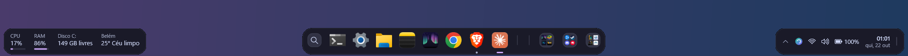
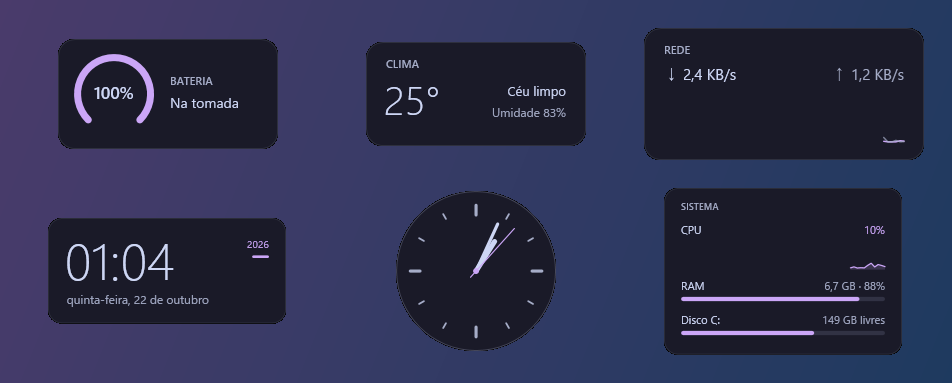
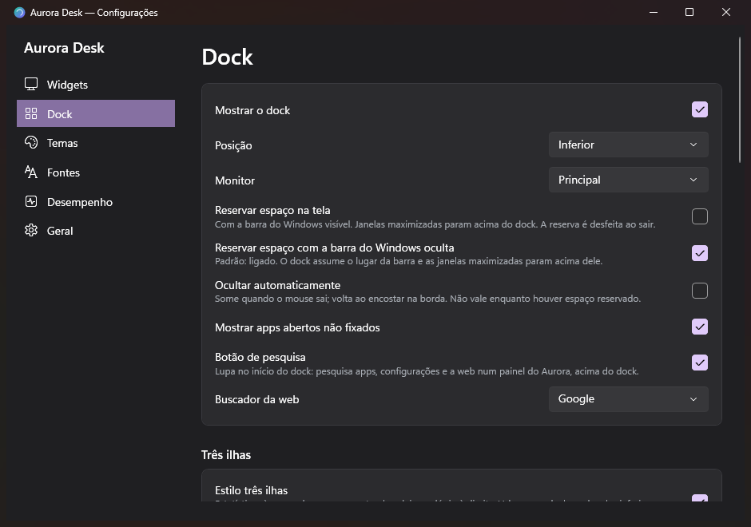
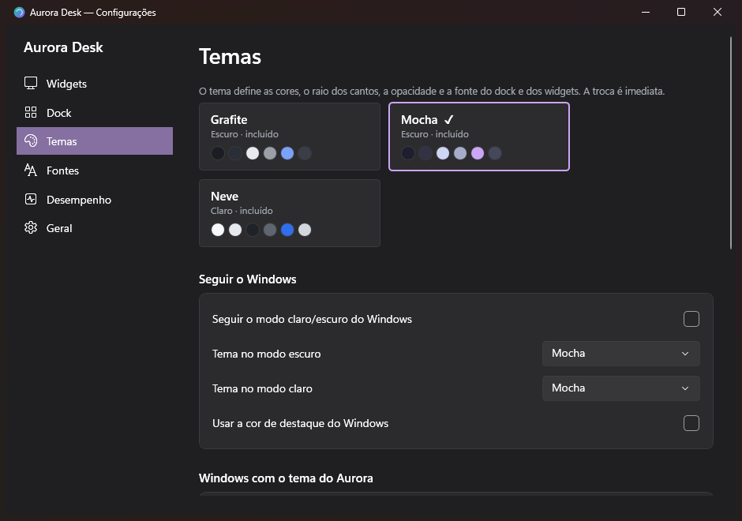

# Aurora Desk

Widgets de área de trabalho (no estilo do Rainmeter), um dock de aplicativos (no estilo do Nexus Dock) e temas e fontes, tudo em **um único processo leve** para Windows 11.

- **Widgets** declarativos em JSON, com recarga automática ao salvar: relógio, monitor do sistema, rede, bateria, clima (opcional) e relógio analógico.
- **Dock** em qualquer borda, flutuante ou reservando espaço, com apps fixados e em execução, ampliação ao passar o mouse, ocultar automático, acrílico e multi-monitor.
- **Temas** (Grafite, Neve, Mocha e os seus) e **fontes** (instaladas ou de uma pasta, sem instalar), com troca imediata. Também pode seguir o modo claro/escuro e a cor de destaque do Windows.
- **Perfis** exportáveis (.zip), **iniciar com o Windows** e **Restaurar original**.
- Sem telemetria e sem rede, exceto o clima (desligado por padrão). Não exige administrador.

## Como é

**Dock em três ilhas**, no lugar da barra de tarefas: estatísticas à esquerda, apps e grupos de atalhos no centro, bandeja e relógio à direita.



**Widgets** de área de trabalho: bateria, clima, rede, relógio digital, relógio analógico e monitor do sistema.



**Configurações** e **temas** com troca imediata (nas imagens, o tema Mocha):

<p>
  
  
</p>

## Baixar e instalar

1. Baixe o `AuroraDesk-Setup-<versão>.exe` na página de [Releases](https://github.com/Maraath/AuroraDesk/releases/latest).
2. Execute. O instalador não pede administrador e já traz o .NET embutido: não precisa instalar mais nada.
3. **Aviso do Windows (SmartScreen):** como o instalador não tem assinatura digital paga, o Windows pode mostrar "O Windows protegeu o computador". Clique em **Mais informações → Executar assim mesmo**. O código-fonte está todo aqui, e o instalador é gerado por `tools\instalador.ps1`.

Bom saber antes de abrir:

- Por padrão, o Aurora **oculta a barra de tarefas do Windows** enquanto está aberto, e o dock assume o lugar dela. Ao fechar o app (ou se ele cair), a barra volta. Dá para desligar no menu do dock ou em Configurações.
- Se ligar "Sincronizar as cores do Windows com o tema", o modo escuro e a cor de destaque do Windows mudam. **Configurações → Geral → Restaurar original** desfaz tudo que o app mudou no Windows.
- Para desinstalar: **Configurações do Windows → Aplicativos instalados → Aurora Desk**. Seus widgets, temas e configurações ficam em `%APPDATA%\AuroraDesk` (o desinstalador pergunta se deve apagá-los).

## Consumo medido

O script `tools\medir.ps1` publica o app em Release, deixa-o ocioso por 60 s com o dock e 4 widgets e lê os números. O histórico completo está em [docs/medicoes.md](docs/medicoes.md).

| Cenário | Private Bytes | Working Set privado¹ | CPU ociosa | Início |
|---|---|---|---|---|
| Dock + 4 widgets (Relógio, Sistema, Rede, Bateria) | **60,2 MB** | 6,4 MB | **0,03%** | 0,8 s |
| Só a bandeja (custo base do WPF) | 55,1 MB | 14,8 MB | 0,00% | 0,6 s |
| Com a janela de configurações aberta | ~83 MB | — | — | — |

¹ É o número que o Gerenciador de Tarefas mostra em "Memória". A tabela vem de um notebook com Windows 11 Pro 26200, Intel UHD + NVIDIA RTX 3050 e .NET 10.0.13.

Metas: até ~80 MB foi **atingida**. A meta ambiciosa de ~50 MB **não foi atingida**: sozinho, o WPF já consome ~55 MB de Private Bytes antes de qualquer janela (ver "Decisões").

## Requisitos

- Windows 10 1903+ ou Windows 11 (alguns recursos visuais são exclusivos do 11).
- Runtime **.NET 10 Desktop** (`Microsoft.WindowsDesktop.App` 10.x) para rodar.
- **SDK .NET 10** para compilar.

## Instalador

```powershell
.\tools\instalador.ps1      # gera artifacts\instalador\AuroraDesk-Setup-<versão>.exe (~43 MB)
```

- **Funciona em qualquer Windows 11 (e Windows 10 20H1+ x64) sem instalar nada antes.** O app é publicado autocontido, com o .NET 10 Desktop Runtime embutido na própria pasta. Não precisa de internet nem de .NET no PC, e não interfere em outros programas .NET.
- **Sem administrador**: instala só para o usuário em `%LOCALAPPDATA%\Programs\Aurora Desk`.
- O instalador cria o atalho no menu Iniciar (mais "Configurações do Aurora Desk"). Opcionalmente, cria um atalho na área de trabalho e liga "Iniciar com o Windows" (marcado por padrão).
- O app aparece em **Configurações → Aplicativos instalados**, de onde se desinstala.
- Ao atualizar ou desinstalar, o app aberto é fechado com calma: a barra do Windows e o espaço do dock voltam antes de os arquivos serem trocados.
- A desinstalação remove a inicialização com o Windows e pergunta se apaga as configurações, widgets, temas e fontes. A resposta padrão é **não**, para reaproveitar numa reinstalação.
- Linha de comando (silencioso): `AuroraDesk-Setup-0.1.0.exe /VERYSILENT /TASKS="iniciar"`.
- O teste automatizado está em `tools\teste-instalador.ps1`: instala, abre, atualiza com o app aberto e desinstala, conferindo arquivos, atalhos, registro e a barra.
- A RAM medida da versão instalada é igual à da versão dependente do runtime (~59 MB). O início leva ~1,7 s (contra 0,8 s), porque o runtime é carregado da pasta do app. Na primeira execução depois de instalar, pode levar alguns segundos enquanto o antivírus examina os arquivos novos.
- O instalador não tem assinatura digital. Por isso, o Windows SmartScreen pode avisar "Editor desconhecido" ao baixá-lo; nesse caso, use "Mais informações → Executar assim mesmo". Para assinar, é preciso um certificado de assinatura de código.
- Para gerar o instalador, é preciso o [Inno Setup 6](https://jrsoftware.org/isinfo.php).

## Compilar, testar e publicar

```powershell
dotnet build AuroraDesk.slnx -c Release
dotnet test --project tests\AuroraDesk.Core.Tests
.\tools\publicar.ps1          # gera artifacts\publish\AuroraDesk.exe (win-x64, ReadyToRun, dependente do runtime)
.\artifacts\publish\AuroraDesk.exe
```

O app tem uma instância só. Uma segunda execução abre as configurações da primeira. Argumentos:

- `--configuracoes` abre a janela de configurações.
- `--sair` fecha a instância aberta.

## Como usar

- **Bandeja**: clique esquerdo abre as configurações. O clique direito abre o menu rápido: tema, widgets, mostrar/ocultar widgets, opções do dock, mostrar/ocultar dock, configurações e sair.
- **Widgets**:
  - Arraste para mover. Perto das bordas, o widget encaixa sozinho.
  - O clique direito abre o menu do widget: camada, opacidade, escala, travar, clique através, editar skin, abrir pasta, recarregar e fechar.
  - Camadas: "na área de trabalho" (logo acima do papel de parede, abaixo das janelas), "normal" ou "sempre no topo".
- **Dock**:
  - **Grupos de atalhos**: clique direito no dock → "Criar grupo de atalhos", ou num atalho → "Mover para o grupo".
    - No dock, o grupo mostra as miniaturas dos 4 primeiros atalhos. Clicar abre um painel com todos eles, acima do dock.
    - Arraste arquivos ou atalhos para cima do grupo (ou para dentro do painel) para adicionar. No painel, clique no título para renomear e use o clique direito num atalho para tirá-lo ou devolvê-lo ao dock.
    - "Desagrupar" devolve todos os atalhos ao dock.
  - Clique abre o app ou traz a janela à frente. Clicar no app ativo minimiza; com várias janelas, alterna entre elas. O clique do meio abre uma nova janela.
  - Arraste arquivos, atalhos e pastas para fixar. Arraste um item para reordenar ou para fora do dock para desafixar.
  - O clique direito mostra janelas, fechar, fixar/desafixar, abrir local do arquivo e as opções do dock.
- **Dock em três ilhas** (padrão, nas bordas inferior e superior):
  - **Esquerda, estatísticas**: CPU e RAM com barrinha de uso, rede (download), clima da sua cidade e, opcionalmente, disco C: e bateria. Clicar na CPU ou na RAM abre o Gerenciador de Tarefas.
  - **Centro**: a **lupa de pesquisa**, seguida dos apps. A lupa abre a **pesquisa do Aurora**, um painel com as cores do tema logo acima do dock, sem mostrar a barra do Windows. Ela procura:
    - os apps do menu Iniciar (programas e Store, com ícones);
    - as configurações do Windows mais usadas (Wi-Fi, Bluetooth, Tela, Som...);
    - a web, no navegador padrão (Google, Bing ou DuckDuckGo).

    A busca ignora acentos e pontuação ("configuracoes", "wifi") e entende iniciais ("vsc" → Visual Studio Code). As setas navegam, Enter abre, Esc ou um clique fora fecha.

    Para arquivos, o último resultado leva o termo para a pesquisa do Windows, que mostra a própria barra enquanto está aberta. O painel é criado ao abrir e descartado ao fechar. A lista de apps fica guardada por 10 minutos (só nomes).
  - **Direita, bandeja**:
    - o **ícone do Aurora Desk** (o mesmo menu da bandeja, que some junto com a barra do Windows);
    - Wi-Fi ou cabo e volume (role o mouse para ajustar);
    - bateria, se houver;
    - relógio com data.

    Os ícones do sistema abrem as configurações rápidas do Windows (Win+A) e o relógio abre as notificações e o calendário (Win+N). Enquanto esses painéis estão abertos, o Windows mostra a própria barra por baixo; ela some de novo ao fechá-los.
  - Escolha os itens em Configurações → Dock → Três ilhas. As ilhas usam as mesmas medidas dos widgets, lidas uma vez só.
  - **Ícones dos outros apps da bandeja** (Discord, Steam...): a seta **^** no começo da ilha direita abre o painel de ícones da bandeja do próprio Windows, logo acima da ilha. Clique esquerdo, direito, menus e arrastar funcionam como sempre. Pode ser desligada em Configurações → Dock → Três ilhas.
    - Por que o painel do Windows, e não os ícones desenhados dentro da ilha: no Windows 11, a bandeja não entrega os ícones a outros programas. A interface antiga (`ITrayNotify`) não devolve nada, e a árvore de acessibilidade fica vazia com a barra oculta.
    - A alternativa seria o app se registrar como a barra do Windows para receber os ícones, como fazem barras substitutas como o RetroBar. Isso exige repassar ao Explorer todas as mensagens de bandeja e de AppBar dos outros programas, e é invasivo demais para o objetivo de "leve e reversível".
    - A seta usa os atalhos oficiais Win+B (foco na bandeja) e Enter.
- **Configurações**: abas Widgets, Dock, Temas, Fontes, Desempenho e Geral.

## Como criar um widget

Crie uma pasta em `%APPDATA%\AuroraDesk\widgets\<nome>\` com um `skin.json`. O app percebe a pasta nova sozinho; ligue o widget pelo menu da bandeja (Widgets) ou pelas configurações. Cada vez que você salva o arquivo, o widget é recarregado. Se houver erro, o widget mantém a última versão válida e mostra uma faixa vermelha com a mensagem.

```jsonc
{
  // Comentários e vírgula no final são permitidos.
  "nome": "Meu monitor",
  "autor": "Você",
  "tamanho": [260, 120],          // largura e altura em pixels lógicos (escala 100%)
  "fundo": true,                  // painel com a cor ("@painel") e o raio do tema
  // "fundo": { "cor": "@superficie", "raio": 6, "borda": "@borda" },   // ou personalizado
  // "tema": "Mocha",             // opcional: este widget usa outro tema
  // "fonte": { "familia": "Inter", "tamanho": 13 },   // opcional: fonte do widget

  "medidas": {
    // nome livre → { "tipo": ..., opções..., "intervalo": 500 | "2s" | "1min" }
    "cpu":    { "tipo": "cpu", "intervalo": "1s" },
    "nucleo1":{ "tipo": "cpu", "nucleo": 1 },
    "ram":    { "tipo": "memoria" },                        // % de uso
    "ramGB":  { "tipo": "memoria", "modo": "usada" },       // bytes (use :bytes ou o texto padrão)
    "hora":   { "tipo": "relogio", "formato": "HH:mm" },    // atualiza na virada do minuto
    "down":   { "tipo": "rede", "direcao": "download" }
  },

  "elementos": [
    // Desenhados na ordem da lista (o primeiro fica no fundo).
    { "tipo": "texto", "texto": "CPU {cpu:0}% · {ramGB}", "x": 16, "y": 12, "tamanho": 14, "cor": "@texto" },
    { "tipo": "texto", "texto": "{hora}", "x": 244, "y": 10, "alinhamento": "direita", "peso": "SemiBold", "cor": "@destaque" },
    { "tipo": "barra", "medida": "ram", "x": 16, "y": 40, "largura": 228, "altura": 6, "cor": "@destaque", "fundo": "@superficie" },
    { "tipo": "grafico", "medida": "cpu", "x": 16, "y": 56, "largura": 228, "altura": 48, "amostras": 60,
      "cor": "@destaque", "preenchimento": "@destaque/20" },
    { "tipo": "arco", "medida": "nucleo1", "x": 200, "y": 70, "largura": 40, "altura": 40, "espessura": 5,
      "inicio": 135, "abertura": 270, "fundo": "@superficie" },
    { "tipo": "texto", "texto": "Abrir Gerenciador", "x": 16, "y": 100, "tamanho": 11,
      "cor": "@textoSecundario", "acao": "taskmgr.exe" }      // "acao": programa, pasta ou URL ao clicar
  ]
}
```

### Medidas

| tipo | opções | valor / texto | intervalo padrão |
|---|---|---|---|
| `cpu` | `nucleo` (1..N; sem ele, total) | % | 1 s |
| `memoria` | `modo`: `uso` (%), `usada`, `livre`, `total` (bytes) | % ou bytes | 2 s |
| `disco` | `unidade` (`C:`), `modo` igual ao da memória | % ou bytes | 30 s |
| `rede` | `direcao`: `download`, `upload`, `total`; `maximo` (bytes/s, opcional) | bytes/s; o máximo se ajusta sozinho | 1 s |
| `bateria` | `modo`: `nivel` (%) ou `estado` (texto) | % / "Carregando", "Na bateria"... | 30 s |
| `relogio` | `formato` (padrão `HH:mm`) | texto; alinhado ao segundo/minuto | 1 s ou 1 min |
| `uptime` | — | "3d 4h 12m" | 1 min |
| `clima` | `campo`: `temperatura`, `descricao`, `umidade`, `vento`, `codigo` | Open-Meteo; precisa ser ligado nas configurações | 1 min (consulta a cada 30 min) |

Formatos de data: `d dd ddd dddd M MM MMM MMMM yy yyyy H HH h hh m mm s ss tt`. Texto literal vai entre aspas simples (`'de'`). Os nomes de dias e meses seguem o idioma (Configurações → Geral).

Medidas iguais (mesmo tipo e opções) em widgets diferentes são **lidas uma vez só**. Uma medida sem nenhum widget usando não é lida.

### Textos

- `{nome}` mostra o texto padrão da medida.
- Campos: `{nome.pct}` (porcentagem), `{nome.max}` e `{nome.valor}`.
- Formatos: `:0`, `:0.0` (casas decimais), `:bytes`, `:maiusculas`, `:minusculas`. Exemplo: `{ram.max:bytes}`. Use `{{` e `}}` para chaves literais.

### Elementos

| tipo | propriedades |
|---|---|
| `texto` | `texto`, `fonte`, `tamanho`, `peso` (Light, Normal, SemiBold, Bold...), `italico`, `alinhamento` (`esquerda`, `centro`, `direita`), `cor`, `largura` (opcional) |
| `barra` | `medida`, `vertical`, `cor`, `fundo`, `raio` |
| `arco` | `medida`, `espessura`, `inicio` (graus; 0 = 3 horas, sentido horário), `abertura` (até 360), `cor`, `fundo` |
| `grafico` | `medida`, `amostras`, `estilo` (`linha` ou `barras`), `cor`, `preenchimento`, `espessura` |
| `imagem` | `arquivo` (relativo à pasta do skin), `ajuste` (`uniforme`, `preencher`, `nenhum`) |
| `forma` | `forma` (`retangulo` ou `elipse`), `preenchimento`, `contorno`, `espessuraContorno`, `raio` |
| `relogioAnalogico` | `segundos`, `mostrador`, `ponteiroHoras`, `ponteiroMinutos`, `ponteiroSegundos`, `marcas` |

Todos aceitam `x`, `y`, `largura`, `altura`, `opacidade` e `acao`.

Num texto sem `largura`, `x` é a âncora: a esquerda, o centro ou a direita do texto, conforme o `alinhamento`. Com `largura`, o texto é alinhado dentro da caixa e cortado com "…" se não couber.

**Cores**: `#RGB`, `#RRGGBB`, `#AARRGGBB`, `transparente`, ou uma cor do tema:

- `@fundo`, `@superficie`, `@texto`, `@textoSecundario`, `@destaque`, `@borda`, `@sucesso`, `@alerta`, `@perigo`;
- `@painel` (o fundo com a opacidade do tema);
- `@chave/NN` para NN% de opacidade (ex.: `@destaque/20`).

**Fonte**: a ordem de precedência é elemento → widget (configurações) → skin → global (configurações) → tema.

Posição, camada, escala, opacidade, fonte do widget e monitor ficam no `config.json`, **não** no skin. Por isso, editar o skin não move o widget.

## Como criar um tema

Em Configurações → Temas → "Duplicar tema atual", ou crie `%APPDATA%\AuroraDesk\themes\meu-tema.json`:

```jsonc
{
  "nome": "Oceano",            // aparece no menu da bandeja e nas configurações
  "escuro": true,
  "raio": 12,                  // raio dos cantos do dock e dos painéis
  "opacidade": 0.85,           // opacidade do "@painel"
  "fonte": "Segoe UI Variable Text",
  "tamanhoFonte": 13,
  "cores": {
    "fundo": "#0F1A24", "superficie": "#18293A", "texto": "#E6F1FF",
    "textoSecundario": "#8DA2B8", "destaque": "#4FD1C5", "borda": "#24394E",
    "sucesso": "#7DD3A8", "alerta": "#F5C26B", "perigo": "#F28B82",
    "minhaCor": "#FF7AB6"       // cores extras podem ser usadas nos skins como "@minhaCor"
  }
}
```

Cores ausentes recebem o padrão. Um tema com o nome de um dos incluídos o substitui. Ao salvar o arquivo, o tema é recarregado e, se estiver ativo, aplicado na hora.

## Como adicionar fontes

Copie arquivos `.ttf` ou `.otf` para `%APPDATA%\AuroraDesk\fonts\`. Elas são carregadas direto do arquivo, **sem instalar no Windows**, e aparecem primeiro no seletor (Configurações → Fontes, com pré-visualização). Use o nome da família no skin (`"fonte": "Inter"`), na fonte do widget ou como fonte global. Se uma fonte sumir, o app usa Segoe UI Variable em seu lugar.

## Barra de tarefas do Windows

Com a opção **"Ocultar a barra de tarefas do Windows enquanto o Aurora Desk estiver aberto"** ligada (padrão), o dock substitui a barra.

- Ligue ou desligue em Configurações → Geral, no menu da bandeja ou no clique direito do dock.
- Ao fechar o app, a barra volta exatamente como estava, inclusive se "ocultar automaticamente" estava ligado.
- Se o app cair ou for encerrado pelo Gerenciador de Tarefas ("Finalizar tarefa"), o processo vigia `AuroraDesk.exe --vigia` devolve a barra em menos de 1 s.
- Com a barra oculta, o ícone da bandeja do Aurora Desk some junto. Abra as configurações pelo **clique direito no dock** ("Configurações do Aurora Desk" e "Sair") ou executando o `AuroraDesk.exe` de novo.
- Os atalhos do Windows continuam funcionando: Win (Iniciar), Win+A (configurações rápidas) e Win+N (notificações e calendário).
- Com a barra oculta, o dock **reserva o espaço dela** por padrão: as janelas maximizadas param logo acima do dock, como fariam com a barra.
  - Desligue em Configurações → Dock → "Reservar espaço com a barra do Windows oculta", ou pelo clique direito no dock.
  - Com a barra do Windows visível, vale a opção normal "Reservar espaço na tela" (padrão: flutuante).
  - A reserva é devolvida ao fechar e refeita se o Explorer reiniciar.
- Caso extremo: se o app e o vigia forem encerrados juntos ("Finalizar árvore de processos"), a barra fica oculta até você abrir o Aurora Desk de novo (que a gerencia) ou usar **Restaurar original**.

## Windows com o tema do Aurora

Fica em Configurações → Temas. Leva o tema para o resto do PC **sem entrar em outros programas**, só pelas opções oficiais do Windows:

- **Sincronizar as cores do Windows com o tema.** O app grava no registro do usuário:
  - modo escuro ou claro conforme o tema;
  - cor de destaque do Windows igual ao destaque do tema, com a paleta de 8 tons;
  - "mostrar a cor de destaque nas barras de título e bordas".

  Ao trocar o tema no Aurora, o Windows acompanha. Os valores originais são guardados e voltam ao fechar o app (padrão; dá para desligar e manter as cores) ou com Restaurar original. Enquanto essa opção estiver ligada, "seguir o Windows" fica desativado, para os dois não se realimentarem.
- **Barra de título, abas e borda das janelas nas cores do tema.** O app pede ao gerenciador de janelas do Windows (DWM, `DwmSetWindowAttribute` de fora, como faz o Mica For Everyone) para pintar a barra, o texto e a borda de cada janela, em todas as janelas ou só no Explorador de Arquivos.
  - No Explorer, isso colore a faixa das abas.
  - Apps que desenham a própria barra mostram só a borda.
  - Como alguns apps, entre eles o Explorer, redefinem a cor logo depois de abrir, o app reaplica a cor alguns instantes depois e sempre que a janela ganha o foco.
  - Ao desligar ou fechar o app, as janelas voltam às cores padrão.

O limite: o fundo, o painel lateral e o conteúdo do Explorer seguem o modo escuro ou claro do Windows. Pintar o Explorer por dentro exigiria injetar código no `explorer.exe`, como fazem o Windhawk e o ExplorerBlurMica. O Aurora não faz isso: é a mesma técnica usada por malware, aciona antivírus, pode derrubar a área de trabalho e quebra com atualizações. Essas ferramentas podem ser usadas à parte, por sua conta, junto com o Aurora.

## Perfis e Rainmeter

- **Exportar/Importar perfil** (Configurações → Geral): um `.zip` com tema, widgets, fontes e configuração do dock. A importação:
  - salva o estado atual em `backup\` antes;
  - recusa caminhos fora das pastas (zip slip) e executáveis (`.exe`, `.ps1`, `.lnk`...);
  - limita o tamanho a 200 MB.
- **Importar skin do Rainmeter (.ini)** (Configurações → Widgets) converte um **subconjunto** do formato:
  - `[Variables]`;
  - medidas CPU, PhysicalMemory, FreeDiskSpace, NetIn/NetOut/NetTotal, Time, Uptime e PowerPlugin;
  - meters String, Bar, Roundline, Line/Histogram e Image;
  - posições `r`/`R`.

  Scripts Lua, plugins, fórmulas `Calc`, `MeterStyle`, Shape e ações (bangs) não são importados, e o app lista o que ficou de fora. O formato do Rainmeter é, na prática, uma linguagem com plugins nativos e scripts; executá-los quebraria a regra "sem código de terceiros rodando no processo". Por isso o objetivo é converter os skins simples, não emular o Rainmeter inteiro.

## Como medir o consumo

```powershell
.\tools\medir.ps1 -Publicar -Rotulo "minha mudança"       # 60 s; anexa em docs\medicoes.md
.\tools\medir.ps1 -Segundos 120 -ManterAberto             # sem publicar, sem fechar no fim
.\tools\experimentos.ps1                                  # compara variações de GC/JIT
```

O script mostra Private Bytes, Working Set (total, pico e privado), CPU média ociosa (dos 10 s em diante) e o pico de 1 s, handles, threads e o tempo de inicialização, que o próprio app grava no log. A aba **Desempenho** das configurações mostra os mesmos números ao vivo.

## Segurança e privacidade

- Nada exige administrador. O app só mexe no usuário atual: a chave `HKCU\...\Run` (se você ligar "Iniciar com o Windows") e a reserva de espaço do dock (AppBar, devolvida ao sair).
- **Restaurar original** devolve os valores do registro guardados em `backup\windows-original.json`, libera o espaço do dock e mostra a barra de tarefas de novo (desligando a opção de ocultá-la).
- **Barra de tarefas do Windows**: por padrão, fica **oculta enquanto o Aurora Desk estiver aberto** e volta sozinha quando ele fecha. Veja "Barra de tarefas do Windows" abaixo.
- **Cores do Windows**: só mudam se você ligar "Windows com o tema do Aurora" (Temas). Os valores originais vão para `backup\windows-original.json` e voltam ao fechar o app (opção) ou com Restaurar original. O papel de parede não é alterado.
- Rede: só o clima, se você ligar, usa a internet.
  - O tempo é consultado em `api.open-meteo.com` a cada 30 min, enviando só latitude e longitude.
  - Ao digitar a cidade em Configurações → Geral, o app busca o nome em `geocoding-api.open-meteo.com` (só o texto digitado), preenche a latitude e a longitude da cidade mais provável e mostra as outras com o mesmo nome para escolher.
  - Não há telemetria.
- Falhas são isoladas: uma medida ou um widget com erro é registrado em `%LOCALAPPDATA%\AuroraDesk\logs\aurora.log` (rotativo, até 1 MB) e o resto continua.

## Decisões

- **WPF, não WinUI 3 nem Win32/Direct2D.** O WPF já vem no runtime .NET Desktop (zero pacotes) e permite desenho vetorial direto. Com renderização por software, o processo fica em ~60 MB. Win32 + Direct2D chegaria a ~10–20 MB, mas exigiria reescrever texto, layout e configurações à mão, e por isso ficou fora do escopo. WinUI 3 precisaria do Windows App SDK (dezenas de MB a mais).
- **Renderização por software** (`RenderMode.SoftwareOnly`). Com GPU, o WPF carrega os drivers NVIDIA e Intel no processo: medimos **140 MB contra 55 MB** só com a bandeja. Como os widgets atualizam no máximo 1×/s, o desenho por CPU custa menos de 0,1%. É configurável em Desempenho → Renderização por GPU.
- **Acrílico do dock via "accent policy"**, não via `DWMWA_SYSTEMBACKDROP_TYPE`. O caminho do DWM exige uma superfície por GPU: medimos 156 MB e a janela ficou transparente. A accent policy funciona com a janela desenhada por software (~+1 MB). Mica não é oferecida porque só existe nesse caminho caro.
- **Skins em JSON com comentários** (`System.Text.Json`, que já vem no runtime). TOML exigiria um pacote. As chaves estão em português porque o usuário edita esses arquivos.
- **Um agendador central** (`MeasureScheduler`) com um único timer de disparo único, reprogramado para o próximo vencimento. O app não acorda à toa, e cada medida é lida uma vez por intervalo, compartilhada entre widgets. Só as medidas que mudaram são entregues à interface, num lote.
- **Medidas por chamadas Win32 baratas**: `GetSystemTimes`, `NtQuerySystemInformation`, `GlobalMemoryStatusEx`, `GetDiskFreeSpaceEx`, `GetIfTable2`, `GetSystemPowerStatus` e `GetTickCount64`. Nada de WMI ou PerformanceCounter no app.
- **Widgets desenhados com `DrawingVisual`**, um por elemento, com pincéis e canetas congelados e em cache. Só o elemento afetado é redesenhado. Não há controles nem `Binding` nos widgets.
- **Camada "área de trabalho"**: o widget fica logo acima da janela do desktop (Progman) e intercepta `WM_WINDOWPOSCHANGING`. Não dependemos do WorkerW: no Windows 11 24H2 a hierarquia do WorkerW mudou, e prender o widget lá o deixaria atrás dos ícones e frágil a reinícios do Explorer. No Win+D, os widgets acompanham o desktop: ficam visíveis e voltam para trás das janelas quando elas retornam.

  - O Win+D nem sempre gera um evento de troca de foco, por exemplo quando o desktop já estava ativo. Por isso, enquanto o desktop estiver em primeiro plano, e só nesse período, a ordem Z é conferida a cada 400 ms. Isso custa poucas chamadas `GetWindow` e nenhum redesenho.
  - O teste `tools\teste-area-de-trabalho.ps1` confirma a ordem Z com Win+D e com o reinício do Explorer.
- **Bandeja e menus nativos** (`Shell_NotifyIcon` e `TrackPopupMenuEx`), sem WinForms, que carregaria vários MB. Os menus seguem o modo escuro e o visual do Windows 11.
- **Apps em execução por WinEventHook**, sem varredura periódica. Uma varredura completa acontece só ao iniciar.
- **Ícones** via `IShellItemImageFactory` no tamanho exato, com cache LRU em memória (96 itens) e PNG em disco. Ler o PNG evita carregar extensões do shell no processo.
- **`InvariantGlobalization`** (sem ICU) para economizar RAM. Por isso, nomes de dias e meses e o separador decimal vêm de tabelas próprias (pt-BR e en), cobertas por testes.
- **Runtime**: GC de estação de trabalho não concorrente, `TieredPGO` desligado, ReadyToRun, `UseSystemResourceKeys` e só os recursos pt-BR.
  - Desligar `TieredCompilation` foi medido: −2 MB e −25% de CPU na inicialização, porque o código ReadyToRun não é recompilado.
  - `GCgen0size`, `GCConserveMemory`, `GCHeapHardLimit` e `TC_QuickJitForLoops` não mudaram nada e ficaram de fora.
  - Os números estão em [docs/medicoes.md](docs/medicoes.md).
- **Liberação de memória**: 20 s depois de iniciar e ao fechar as configurações, o app faz um GC compactando e chama `SetProcessWorkingSetSize(-1,-1)`, no máximo a cada 5 min. Isso derruba o Working Set (ex.: 100 → 16 MB) sem mudar o Private Bytes; as páginas voltam sob demanda.
- **Janela de configurações** com o tema Fluent do WPF (`ThemeMode.Dark`, que o .NET 10 ainda marca como experimental), montada em código e descartada ao fechar. Ela custa ~20 MB enquanto aberta; ao fechar, ~7 MB de bibliotecas continuam carregadas.
- **Dock reservando espaço** (AppBar): com a barra do Windows oculta, vem ligado por padrão (o dock faz o papel dela). Com a barra visível, o padrão é flutuante. São duas opções separadas, para cada modo lembrar a sua escolha.
- **Barra do Windows oculta enquanto o app está aberto** (pedido do usuário; dá para desligar). O app:
  - grava o estado original em `backup\barra-de-tarefas.json`;
  - liga "ocultar automaticamente", para as janelas maximizadas usarem a tela toda, e esconde a janela da barra;
  - esconde de novo se o Explorer mostrá-la (evento de janela) ou reiniciar.

  Para a barra voltar **mesmo se o app cair ou for encerrado à força**, o app inicia um processo vigia: o próprio `AuroraDesk.exe --vigia <pid>`, sem WPF, com 5,8 MB medidos. Ele só espera o app terminar e então restaura. Se o arquivo de backup já existe (queda anterior), o original antigo é mantido, para nunca "restaurar" para o estado alterado.
- **Interface só em português.** A opção de idioma (pt-BR/en) vale para datas e textos dos widgets.

## Dependências

- **App**: nenhum pacote NuGet. Usa só .NET 10 + WPF + Win32.
- **Testes**: `xunit.v3` (com Microsoft.Testing.Platform, ver `global.json`).

## Estrutura

```
src/AuroraDesk.Core/   núcleo sem interface (testável): medidas, agendador, skins, temas, perfis,
                       importador do Rainmeter, layout do dock, configuração, log
src/AuroraDesk/        app WPF: bandeja, widgets, dock, configurações, interop Win32/COM
tests/                 138 testes do núcleo
tools/                 publicar.ps1, medir.ps1, experimentos.ps1, capturar.ps1, gerar-icone.ps1
docs/medicoes.md       histórico de medições
```

## Limitações conhecidas

- O que foi verificado e o que não foi está na seção "Verificação" de [docs/medicoes.md](docs/medicoes.md).
- A pausa por tela bloqueada e monitor desligado usa as notificações oficiais do Windows, mas não foi testada travando a sessão durante o desenvolvimento.
- Arrastar um app direto do menu Iniciar para o dock não funciona: o menu Iniciar não fornece um arquivo. Fixe pelo menu do app em execução ("Fixar no dock") ou arraste o atalho.

## Licença

[MIT](LICENSE): use, modifique e redistribua à vontade, mantendo o aviso de autoria.
